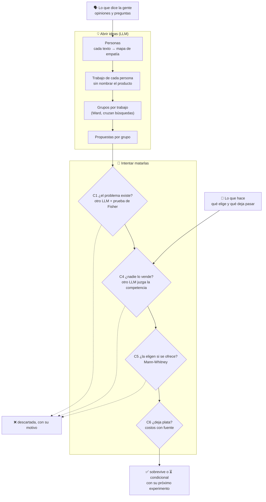

# Faltante

**Pregunta que responde:** ¿puede un sistema con un modelo de lenguaje encontrar productos que
convendría importar para vender en Mercado Libre, que nadie está trayendo y que no son obvios,
mejor que las reglas simples que usan hoy las herramientas para vendedores?

**Para quién:** importadores y vendedores chicos que deciden qué traer.

**Idea:** automatizar la función empresarial (Kirzner, Huerta de Soto): ver un desajuste
(alguien necesita algo que el mercado local no ofrece y otro ya fabrica afuera) y, antes de
recomendarlo, buscar con datos lo que lo refutaría. Solo se recomienda lo que resiste.

TP de IA Agéntica, Maestría en Explotación de Datos (UBA), 2026.

## Cómo funciona

Parte de dos cosas que la gente muestra en Mercado Libre: **lo que hace** (en cada búsqueda, qué
elige y qué deja pasar) y **lo que dice** (opiniones de compradores y preguntas de indecisos).

1. **Abrir ideas.** Un LLM lee cada opinión como una persona (qué quiere lograr, qué le molesta,
   qué teme) y escribe el **trabajo** que intenta hacer, sin nombrar el producto ("tomar agua
   fresca en salidas con calor"; Ulwick, Jobs-to-be-Done). El código agrupa los trabajos por
   significado (modelo de oraciones y Ward, como Timoshenko y Hauser 2019) y se queda con los
   grupos que juntan gente de búsquedas distintas a la que el trabajo le sale mal. Para cada
   grupo, el LLM propone qué traer.
2. **Intentar matarlas.** Cada propuesta tiene que pasar cuatro preguntas, y en cada una hay un
   dato que puede tirarla abajo:
   - **C1** ¿Ese problema le pasa de verdad a esa gente, más que a gente al azar?
   - **C4** ¿Nadie lo vende ya en Mercado Libre? (C3, antes, pide que haya demanda de origen)
   - **C5** Cuando alguien lo ofrece, ¿la gente lo compra o lo deja pasar?
   - **C6** ¿Deja plata después de comisión, impuestos, envío, publicidad y devoluciones?

La regla de fondo: **el modelo que propone nunca es el que evalúa.** El problema lo mide otro
modelo que no sabe qué se propuso; la competencia la juzga otro; las cuentas las hace el código.



**Ejemplo real (dev).** Entre las opiniones de máquinas de cortar pelo aparece gente como "la
compré para mi hija pero la uso más yo". El LLM arma el grupo "corta el pelo en casa" y propone
una guía con nivel para cortarse el flequillo. **C1:** otro modelo lee 150 textos de esos
productos y 150 al azar: 18 tienen ese miedo sin resolver, contra 0 al azar. **C4:** hay 8 guías
publicadas y ninguna vendió +100; todas llegan solo por Compra Internacional (hueco de acceso).
**C5:** nadie tuvo la opción local de dejarla pasar. **C6:** al precio que se pide deja 22% neto,
pero nadie lo pagó todavía: **condicional**, el próximo experimento es probar el precio.
**Una que murió:** un quitapelos de mascotas pasaba C4 porque el criterio de qué era competencia
lo escribía el mismo LLM que lo propuso; en la búsqueda había uno con +10.000 vendidos. Desde
entonces la competencia la juzga otro modelo.

## ¿Sirve? Resultados

Tres comparaciones, prerregistradas antes de correrlas (`data/evaluacion/test/PRERREGISTRO.md`),
cada una contra un rival distinto:

| Rival | Qué hace | Qué responde |
|---|---|---|
| **B1, B2** (sin LLM) | B1 mejora el producto por su queja más frecuente (lo que sugieren las herramientas comerciales); B2 detecta pedidos de repuesto | ¿le gana a las reglas de hoy? |
| **B4** (one-shot) | el mismo modelo, una llamada por producto: lee las opiniones y lo que se ofrece en la búsqueda, se aplica él mismo los cinco criterios y recomienda | ¿le gana a preguntarle al modelo qué importar? |
| **B3** (ablación) | el mismo modelo propone directo, sin personas ni grupos, y pasa por **nuestro** embudo | ¿leer personas y grupos genera mejores ideas? |

**1. Contra las reglas sin LLM, el sistema gana.** Mismo embudo para todos; se cuentan las
oportunidades distintas que no descarta:

| | Programa | B1 | B2 |
|---|---|---|---|
| **test** (136 productos, una sola corrida) | **16** de 109 propuestas | 4 de 136 | 0 de 3 |
| test limpio (90 productos que ninguna versión leyó antes) | **12** de 61 | 4 de 90 | 0 |
| dev (133 productos) | 13 de 135 | 7 de 133 | 2 de 7 |

15% de sus propuestas resiste contra 4% (Fisher unilateral, p = 0,002; en el test limpio,
p = 0,003). Es una sola corrida de un LLM que varía bastante (en el dev chico, la misma versión
dejó 14, 3 y 9), pero la dirección se repitió en dev y en test. Las de B1 no son productos ("una
versión que resuelva la queja 'algo'"); las del programa sí (soga de saltar sin cable, barras de
techo inflables, adaptador digital de torque…).

**2. Contra preguntarle al modelo (B4), el sistema no gana.** B4 es mucho más conservador:
recomienda 10 productos en test y 10 en dev. La medida prerregistrada es el **juicio humano a
ciegas** de las recomendaciones finales de los dos, mezcladas (`data/evaluacion/humano/`): con la
mayoría de tres personas, son concretas, no obvias y las cotizarían 12 de 29 del programa (41%) y
7 de 20 de B4 (35%); Fisher unilateral, p = 0,44. **La regla no se cumple.** Las de B1 y B2,
ninguna. El embudo refuta 9 de las 10 de B4 en cada partición, pero con jueces que no pasaron la
prueba de abajo, ese dato no prueba nada.

**3. La forma de generar ideas: la primera versión era trivial; la nueva empata con proponer
directo (B3).** La versión que corrió en test agrupaba por "situación", pero el 70% de las
reseñas no la cuenta, y los grupos salieron por categoría de producto; con el mismo embudo, B3
dejó más (44 contra 16 en test, 31 contra 13 en dev). La rehicimos agrupando por **trabajo** y
exigiendo que cada grupo cruce búsquedas (`data/evaluacion/trabajos/`): en dev deja **30**
oportunidades de 231 propuestas (13%), contra 13 de la versión vieja y 31 de B3 (13,5%). Pasa la
regla escrita antes (le gana a la vieja) pero no le gana a B3. Contando como una sola idea las
que comparten la mayor parte de la primera página de resultados, el programa baja a 23-30 según
el corte y B3 queda en 30-31: con las repetidas juntas, B3 deja más. Test no se volvió
a correr. Juntando 2 y 3: **lo que más aporta el sistema es el embudo que refuta**; el modelo solo
recomienda con confianza cosas que el mercado ya resuelve.

**Análisis de fallas (test).** De las 109 propuestas del programa, 30 mueren en C1 (el problema
no aparece más que en gente al azar, o aparece en un solo producto), 45 en C4 (ya hay 3 o más que
lo venden) y 18 en C5 (se ofrece y la gente lo deja pasar): el embudo mata el 85%. Ninguna llega
a "sobrevive": las 16 quedan condicionales porque no hay precio de proveedor o nadie lo compró
todavía, y el experimento siguiente es cotizar y probar el precio. Cada una con su motivo en
`data/serendipia/embudo_escala_test_api.json`; el resumen, en `data/evaluacion/test/`.

**Las piezas del embudo se ganaron su lugar con evidencia.** Se compararon en dev con 3 corridas
y una regla escrita antes (`DECISIONES.md`, `data/evaluacion/`): el dolor medido como chequeo
mejoró y como filtro previo no; obligar a los grupos a cruzar búsquedas empeoró y se sacó; el
juez de competencia independiente acertó 32 de 40 desacuerdos a ciegas contra 8 del criterio
viejo. Leer personas y agruparlas por trabajo duplicó las ideas que resisten
frente a agruparlas por situación (dev, 30 contra 13), pero no superó a proponer directo.

**Ningún número está elegido a ojo.** Margen mínimo: la ganancia neta del comercio minorista
(Damodaran, 5,19%). "Ya atendido": 3 o más competidores que venden (Bresnahan y Reiss, 1991).
"La dejan pasar": Mann-Whitney al 5%. Personas medidas en C1: análisis de potencia. Costos de
publicidad, devoluciones, comisión e IIBB: con fuente y en tres escenarios. Cada número dice de
dónde sale en `harness/umbrales.py`, `harness/costo_puesto.py` y `harness/dolor.py`.

## Costo y modelo

Una corrida completa sobre ~135 productos (≈9.000 personas):

| Paso | Llamadas | USD | Tiempo |
|---|---|---|---|
| Leer personas, agrupar, proponer, medir el dolor (C1) | ~1.300 | 3,40 | 22 min |
| Juez de competencia (C4 a C6) | ~180 | 1,79 | 16 min |
| Capturar las búsquedas nuevas en el navegador | ~90 páginas | 0 | ~10 min |
| **Total** | | **≈ 5,20** (≈ USD 0,04 por propuesta) | **≈ 50 min** |

Modelo: **DeepSeek V4.1 Flash** (USD 0,30 / 1,20 por millón de tokens de entrada / salida; la
mitad fuera de hora pico). La versión Pro cuesta 4,4 veces más por token de entrada. Leer y
asignar personas va sin razonamiento (es clasificar); proponer y juzgar, con razonamiento.
Elegimos Flash porque la tarea pide escala (miles de personas) y los dos jueces quedaron
validados con controles; no lo comparamos contra Pro (queda como trabajo futuro). Cada llamada
queda en la traza con tokens, segundos, errores del guardrail y si se cortó.

## Correrlo

Requisitos: Python 3 (la imagen de Docker usa 3.12; los tests también pasan con 3.14), `make` y
las dependencias de `requirements.txt` (`pytest>=8`, `scipy>=1.11`, `anthropic>=1`; el SDK solo se usa si se corre con Claude). `make test` y `make todo`
no necesitan internet ni claves; solo `make serendipia-api` pide `DEEPSEEK_API_KEY`. Sin venv,
`make test` falla con "No module named pytest".

```bash
git clone https://github.com/codewithpatelo/faltante && cd faltante
python3 -m venv .venv && source .venv/bin/activate
make setup     # dependencias
make todo      # tests + el embudo sobre las corridas guardadas de dev y test y el resultado de la hipótesis (sin internet ni claves)
```

O con Docker: `docker build -t faltante . && docker run faltante`. Con `MODELO_LLM=claude-opus-5-5` (y una credencial de Anthropic) los pasos usan Claude en vez de DeepSeek y guardan en archivos con `__<modelo>` al final, sin pisar los de DeepSeek. Con `MODELO_JUEZ=claude-sonnet-5-5` propone el de `MODELO_LLM` y mide el dolor (C1) y la competencia (C4 a C6) Claude, que es de otra familia: el archivo termina en `__juez-claude-sonnet-5-5`. Para juzgar con otro modelo lo que ya está propuesto, sin volver a proponer (solo dev): `MODELO_JUEZ=claude-sonnet-5-5 python -m harness.divergente escala_dev --rejuzgar`, lo mismo con `harness.directo` y `harness.equivalencias <salida>`, y `python -m harness.correr escala_dev_api__juez-claude-sonnet-5-5`; los juicios de competencia de ese juez quedan en `data/serendipia/equivalencias__<modelo>.json`. Para correr el modelo (la
clave es un secreto del repo): pestaña Actions → workflow **llm** → tarea `serendipia` con la
partición; después capturar las búsquedas nuevas (`scripts/captura_ml.js`), correr la tarea
`equivalencias` y `python -m harness.correr <particion>_api`.

## Datos

| Qué | Volumen | Dónde |
|---|---|---|
| Productos ancla: los 2 más vendidos de cada búsqueda | dev: 133 productos de 71 búsquedas; test: 136 de 71, apartados por hash de la búsqueda antes de leerlos | `data/escala/corpus_*.json` |
| Cómo se eligieron las búsquedas | 99 categorías hoja del árbol de Mercado Libre sorteadas en proporción a sus publicaciones, en 9 rubros de consumo importables, más 47 del corpus inicial | `scripts/muestrear_categorias.js` |
| Opiniones y preguntas | 43.900 textos (dev: 21.745 → 9.205 personas; test: 22.155 → 8.585) | mismos archivos |
| Búsquedas capturadas (para C3 a C6) | 1.044 búsquedas | `data/capturas/` |
| Precios de proveedor | Alibaba con el descuento citado para 1688 y la comisión del agente: estimados | `data/serendipia/fob_*.json` |

Fuente: páginas públicas de Mercado Libre leídas desde un navegador con sesión iniciada (la API
de búsqueda devuelve 403), noviembre 2026; solo texto visible, sin nombres de usuarios; uso
académico.

## Qué podría tirar esto abajo

Buscamos a propósito los supuestos que, si fallan, invalidan el resultado, y medimos los que se
podían medir:

- **Rivales débiles.** Ganarle a reglas sin LLM prueba poco: por eso B4 (el modelo solo, de
  punta a punta) y B3 (la generación sola). B3 desnudó que la primera generación era trivial (arriba).
- **El LLM escribe la búsqueda con la que después se lo juzga.** Una búsqueda rebuscada trae pocos
  competidores y pasa C4 sola. Medido: las que quedan no tienen búsquedas con menos resultados
  que las que mueren (mediana 246 contra 231 en dev, p = 0,89; 167 contra 205 en test, p = 0,32).
  Hay casos sueltos (una búsqueda devolvió 5 resultados), y B3 también escribe las suyas.
- **El dolor se mide con los mismos textos de donde salió la idea.** Si se saca a las personas que
  el LLM citó, las propuestas con dolor significativo bajan de 257 a 238 (7%): pesa poco.
- **El mismo modelo propone y juzga.** Los jueces son llamadas aparte que no saben qué método
  propuso, así que un sesgo a favor de lo propio (Zheng et al., 2023) favorece igual al programa
  y a B3.
- **Los dos jueces del embudo fallan donde importa** (`data/evaluacion/humano/prueba_jueces.py`).
  La primera planilla no servía para medirlos (casi todas las filas se contestaban con "dolor no,
  equivalencia sí"), así que armamos una prueba con casos dudosos, mitad sí y mitad no según cada
  juez, escrita antes de contestarla. Con el juicio de una persona (Patricio): cuando el juez de
  competencia dice que una publicación **no** compite, en 8 de 10 sí compite; cuando el juez de
  dolor dice que alguien tiene el problema sin resolver, en 6 de 10 no lo tiene. Ninguno acierta
  más que responder siempre lo mismo (11 de 20 contra 17 y 13). Los dos errores inflan lo que
  sobrevive: C4 cuenta menos competidores de los que hay y C1 ve dolor que no está. Por eso las
  oportunidades "no descartadas" (del programa y de los baselines) no se pueden leer como
  oportunidades reales, y la comparación entre métodos vale solo en la medida en que el error
  sea parejo para todos.
- **"No descartada" no es "buena".** Ninguna llega a "sobrevive": todas quedan condicionales
  porque el precio de proveedor es estimado y nadie lo pagó todavía. El conteo dice que ningún
  dato la refutó, no que sea rentable; eso lo dicen el juicio humano a ciegas y una cotización.
- **Una sola corrida en test**, con un LLM que varía entre corridas, y 46 de sus 136 productos ya
  se habían leído antes (por eso el subconjunto limpio).
- **Datos:** "+N vendidos" es un piso, no las ventas; C5 no puede descartar lo que casi no tiene
  alternativas; la logística supone carga consolidada (un importador chico trae por courier); el
  corpus ampliado no tiene preguntas de indecisos.

## Mapa del repo

`harness/` el programa (`personas.py` pasos de lectura y grupos; `divergente.py` propuestas y
medición del dolor; `dolor.py` C1; `equivalencias.py` juez de competencia; `chequeos.py` y
`embudo.py` los supuestos críticos; `baselines.py` B1 y B2; `directo.py` B3 y B4; `modelo.py` cliente, reintentos y
costo) · `skills/` un skill por paso del LLM · `scripts/` captura desde el navegador ·
`tests/` · `data/evaluacion/` cada comparación con su prerregistro · `CONSIGNA.md` cumplimiento
de la consigna, áreas en profundidad y antecedentes · `DECISIONES.md` qué elegimos y con qué
evidencia · `BITACORA.md` cómo llegamos acá, con lo que no funcionó · `AGENTS.md` reglas para
los asistentes de código.
