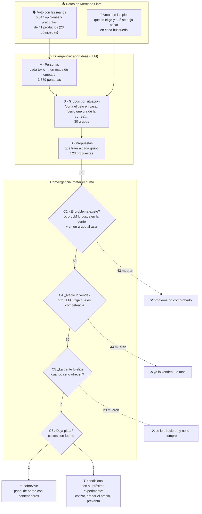

# Faltante

**Qué hace:** descubre desfasajes de mercado para importar y vender en Mercado Libre: un grupo de
gente con un dolor que el mercado local no atiende, y algo que ya se fabrica afuera y lo resuelve.
Automatiza la función empresarial (Kirzner, Huerta de Soto): ver el desajuste y, antes de
recomendarlo, buscar con datos lo que lo refutaría. Solo se recomienda lo que resiste.

Parte de las **elecciones** de la gente, que se ven de dos maneras:

- **Voto con los pies, lo que la gente hace:** frente a las opciones de una búsqueda, qué elige y
  qué deja pasar.
- **Voto con las manos, lo que la gente dice:** opiniones de quienes compraron y preguntas de
  quienes todavía dudan.

**Primero abre ideas (divergencia).** Un LLM lee cada opinión y cada pregunta como si fuera una
persona: en qué situación está, qué quiere lograr, qué le molesta. Después junta a la gente que
está en la misma situación aunque haya comprado cosas distintas (por ejemplo, "corta el pelo en
casa a sus hijos o a sí mismo"), y para cada grupo propone qué traer que hoy no encuentra.

**Después intenta matar cada idea (convergencia).** Cada propuesta tiene que pasar cuatro
preguntas, y en cada una hay un dato que puede tirarla abajo:

1. ¿Ese problema le pasa de verdad a esa gente, más que a gente al azar?
2. ¿Nadie lo vende ya en Mercado Libre?
3. Si alguien lo ofrece, ¿la gente lo compra o lo deja pasar?
4. ¿Deja plata al precio que pagan?

La regla de fondo: el modelo que propone una idea nunca es el que la evalúa. El problema lo mide
otro modelo que no sabe qué se propuso, la competencia la juzga otro modelo, y las cuentas las
hace el código.

TP de IA Agéntica, Maestría en Explotación de Datos (UBA), 2026.

## ¿Sirve? Estado al 06/11/2026 (escala_dev)

| Pregunta | Respuesta hoy |
|---|---|
| ¿Propone cosas no obvias? | **Parece que sí, falta el juicio humano.** De 123 propuestas, 7 pasan del dolor a "la eligen" (C1 a C5): masajeador de espalda de pared, guía para cortarse el flequillo, arnés de cabeza para perros que tiran, aspirador de pelo para peluquería, sombrilla de techo para auto, panel de pared con contenedores, kit de parches para tapizado. Ninguna es un repuesto ni "lo mismo pero mejor". Falta que alguien del grupo juzgue a ciegas si son obvias. |
| ¿Mata el humo, con un motivo verificable? | **Sí.** 43 mueren porque el dolor no aparece más que en gente al azar o solo en un producto; 44 porque ya hay 3 o más que venden lo mismo; 29 porque la gente tuvo la alternativa enfrente y la dejó pasar. Cada una queda con su motivo en `data/serendipia/embudo_escala_dev_api.json`. |
| ¿Deja plata? | **Una pasa y seis quedan condicionales.** El panel de pared deja 9,5% neto a $154.116 (el sector gana 5,2%), con el precio de una sola publicación. Las demás dependen de que la gente pague lo que hoy se pide (nadie lo compró todavía) o de cotizar más barato. Los precios de proveedor son estimados, no cotizados: el próximo experimento es pedir cotización. |
| ¿Es mejor que no usar un LLM? | **En dev, sí; test todavía no se corrió.** Con el mismo embudo, los baselines sin LLM dejan una condicional cada uno: B1 (queja más frecuente), "una versión que resuelva la queja 'saludos'", que no es un producto; B2 (pedidos de repuesto), el repuesto de una aspiradora de auto, que solo cierra con un FOB ≤ USD 1,76. |
| ¿Cada pieza se ganó su lugar? | **Sí, con evidencia.** Cada cambio se comparó en escala_dev con 3 corridas y una regla escrita antes (`DECISIONES.md`, `data/evaluacion/`). Lo que no mejoró se sacó. |

**Lo que falta para decir que sirve:** juicio humano a ciegas de obviedad; cotizaciones reales
de las que sobreviven; logística por courier (hoy se modela carga consolidada); y correr test una
sola vez con todo congelado.

## Cómo funciona

Lo que pasó en la última corrida de escala_dev, paso por paso:



### Una idea de punta a punta: la guía para cortarse el flequillo

1. **Personas.** Entre las opiniones de una máquina de cortar pelo (+50.000 vendidos) aparece gente
   como "estoy aprendiendo a cortar con mi pareja" o "la compré para mi hija pero la uso más yo".
2. **Grupo.** El LLM junta a 107 personas en "corta el pelo en casa, a la familia o a sí mismo",
   aunque compraron productos distintos.
3. **Propuesta.** Una guía con nivel que agarra el mechón para cortar flequillo y puntas parejos.
   El dolor que alivia: el miedo a cortar desparejo y tener que ir a la peluquería a arreglarlo.
4. **C1, ¿el problema existe?** Otro modelo, que no sabe qué se propuso, lee 150 textos de esos
   productos y 150 de gente al azar: 18 tienen ese miedo sin resolver, contra 0 al azar. Pasa.
5. **C3, ¿hay demanda?** El producto de origen vende +50.000. Pasa.
6. **C4, ¿nadie lo vende?** Hay 8 guías publicadas y ninguna vendió +100. Todas llegan solo por
   Compra Internacional: el hueco es de acceso. Pasa.
7. **C5, ¿la eligen?** No hay ninguna con stock local, así que nadie tuvo la opción de dejarla
   pasar. Pasa (sin evidencia en contra, que no es lo mismo que evidencia a favor).
8. **C6, ¿deja plata?** Al precio que piden hoy ($21.078) deja 22% neto después de comisión,
   impuestos, envío, publicidad y devoluciones. Pero nadie lo compró todavía a ese precio:
   **queda condicional**. El próximo experimento es probar el precio y cotizar con un proveedor.

### Una idea que murió: el quitapelos de mascotas

En una corrida anterior el LLM propuso un quitapelos de mascotas para tapizados, y pasaba C4
porque el criterio de qué era competencia lo escribía el mismo LLM. Pero en la búsqueda había un
"Quita Pelo Mascota Ropa Tapizados" con +10.000 vendidos. Ahora la competencia la juzga otro
modelo, que en 40 casos etiquetados a ciegas acierta 32 contra 8 del criterio viejo, y esa
propuesta muere en C4.

### Cada etapa en detalle

| Etapa | Supuesto que pone a prueba | El dato que lo tira abajo | Quién |
|---|---|---|---|
| A · personas | — | Cada voz se vuelve un mapa de empatía chico (situación, qué quiere lograr, dolor, ganancia, qué teme, con qué compara) citando un fragmento literal | **LLM** (`skills/leer_personas`) |
| S · segmentos | — | Personas en la misma situación aunque hayan comprado cosas distintas; un segmento tiene que cruzar productos | **LLM** (`skills/agrupar_personas`) |
| B · propuestas | — | Por segmento, qué necesita y no ve en su góndola, escrito como propuesta de valor; dos tandas, la segunda distinta | **LLM** (`skills/proponer_a_un_segmento`) |
| Guardrail | Lo que dice el LLM está en los textos | Cita un texto que no existe, un fragmento que no está, o menos de 2 personas en cada uno de 2 productos | Código |
| C1 dolor | El dolor que dice aliviar existe y está mal resuelto | Otro modelo, que no sabe qué se propone, no encuentra a quienes lo tienen sin resolver más seguido que en gente al azar (Fisher, Benjamini-Hochberg), o los encuentra en un solo producto | **LLM que mide** (`skills/medir_dolor`) + código |
| C3 demanda | Hay gente eligiendo el producto de origen | Vende menos que la publicación típica (+500; la mediana es +100) | Código |
| C4 hueco | Nadie lo vende todavía | 3 o más equivalentes ya venden como la publicación típica (Bresnahan y Reiss: con 3 a 5 competidores el mercado ya compite) | **LLM que juzga equivalencias** (`skills/juzgar_equivalencia`) + código |
| C5 la eligen | Si se ofrece, la gente lo elige | Las alternativas con stock local y precio no atípico venden significativamente menos que lo que la misma gente compra en su búsqueda de origen (Mann-Whitney, 5%) | Código |
| C6 margen | Deja plata al precio que la gente paga | Ganancia neta (comisión, IIBB, envío, publicidad, devoluciones, seguro) menor que la del comercio minorista (5,19%, Damodaran). Si nadie lo compró todavía, queda condicional al precio que se pide; si alcanza solo con un FOB más bajo, condicional a cotizar | Código |
| Evidencia y riesgos | — | A lo que no se descarta: el dolor con su intervalo de Wilson, lo que venden los equivalentes, el margen de pesimista a optimista, y los riesgos definidos | Código (`harness/confianza.py`) |

**Ningún número está elegido a ojo.** Cada uno sale de una fuente, de los datos o de una prueba
estadística, y dice de dónde en `harness/umbrales.py`, `harness/costo_puesto.py` y
`harness/dolor.py`. Lo que todavía no tiene fuente está marcado PENDIENTE.

## Correrlo

```bash
git clone https://github.com/codewithpatelo/faltante && cd faltante
python3 -m venv .venv && source .venv/bin/activate
make setup     # instala dependencias
make todo      # tests + el embudo sobre la última corrida guardada de escala_dev (sin internet ni claves)
```

Con el modelo (DeepSeek), sin compartir claves: `DEEPSEEK_API_KEY` es un secreto del repo y se
corre el workflow **llm** desde la pestaña Actions.

1. Tarea `serendipia`, partición `escala_dev`: personas, segmentos, propuestas y el dolor medido
   de cada una (y de los baselines). Los resultados quedan en el registro de la corrida.
2. Capturar desde el navegador las búsquedas nuevas que propuso (`scripts/captura_ml.js`).
3. Tarea `equivalencias` sobre la salida: el juez dice qué publicaciones son equivalentes.
4. `python -m harness.correr escala_dev_api`: el embudo, sin red.

**Costo de una corrida completa en escala_dev:** ~USD 1,75 (personas, segmentos, propuestas y
dolor) + ~USD 0,85 (equivalencias), con DeepSeek Flash a USD 0,30 / 1,20 por millón de tokens.

## Datos

| Qué | Volumen | Dónde |
|---|---|---|
| Productos ancla (los más elegidos de cada búsqueda), particionados por búsqueda antes de leerlos | escala_dev: 41 productos de 23 búsquedas; escala_test: 46 de 24 | `data/escala/corpus_2026-11-05.json` |
| Opiniones y preguntas de indecisos | escala_dev: 6.547 textos → 3.389 personas | mismo archivo; personas en `data/serendipia/personas_escala_dev_api.json` |
| Búsquedas capturadas (para C3 a C6) | ~770 | `data/capturas/` (solo se agregan) |
| Precios de proveedor | estimados de Alibaba con el descuento citado para 1688 y la comisión del agente | `data/serendipia/fob_*.json` |
| Aranceles, flete, comisión, IIBB, publicidad, devoluciones, envío | con fuente | `harness/costo_puesto.py`, `harness/umbrales.py` |
| Evaluaciones de cada versión | 3 corridas por versión, con prerregistro | `data/evaluacion/` |

Las páginas de Mercado Libre se leen desde un navegador con sesión iniciada: la API de búsqueda
devuelve 403 aun con token válido.

## Mapa

| Archivo | Qué hace |
|---|---|
| `harness/voces.py` | Carga los productos y sus textos y les pone ID (`o12`, `p3`) |
| `harness/personas.py` | Paso A (mapas de empatía) y S (segmentos), con su guardrail |
| `harness/divergente.py` | Paso B (propuestas por segmento) y la medición del dolor de cada propuesta y de los baselines |
| `harness/dolor.py` | C1: mide el dolor en la gente y en un control y decide con Fisher |
| `harness/equivalencias.py` | El juez de qué publicaciones reemplazan a lo propuesto (lo usan C4 a C6) |
| `harness/baselines.py` | B1 y B2: proponer sin LLM, para comparar |
| `harness/embudo.py` | La lista de supuestos críticos, en orden, y cómo se recorre |
| `harness/chequeos.py` | Cómo se prueba cada supuesto |
| `harness/confianza.py` | La evidencia y los riesgos de lo que no se descarta |
| `harness/umbrales.py` · `harness/costo_puesto.py` | Cada número con su fuente · costo puesto e ingreso neto en Mercado Libre |
| `harness/modelo.py` | Cliente de DeepSeek: reintentos, guardrail, costo |
| `harness/correr.py` | Junta las propuestas, las pasa por el embudo y escribe el resultado |
| `scripts/captura_ml.js` · `scripts/voces_ml.js` | Captura de búsquedas y de opiniones y preguntas desde el navegador |
| `tests/test_embudo.py` | Lo que tiene que cumplir cada etapa |
| `CONSIGNA.md` · `DECISIONES.md` · `BITACORA.md` | Requisitos del TP · qué elegimos, contra qué y con qué evidencia · cómo llegamos acá |

## Glosario

- **Voto con los pies / con las manos:** lo que la gente hace (elige o deja pasar) / lo que dice.
- **Mapa de empatía:** quién es, qué quiere lograr, qué le duele, qué gana, qué teme, con qué compara.
- **Desatendido:** quien tiene el dolor y no lo resolvió (los conformes no refutan el dolor).
- **Equivalente:** una publicación que un comprador de lo propuesto podría comprar en su lugar.
- **Condicional:** no está refutada, pero depende de un dato que solo da un experimento (cotización, precio, preventa).
- **Costo puesto / FOB:** costo con el producto en Argentina / precio del proveedor en el puerto de origen.
- **Guardrail:** regla en código que el LLM no puede saltear.

## Limitaciones

- Los precios de proveedor son estimados (Alibaba con el descuento citado para 1688); el precio
  real lo da una cotización.
- La logística supone carga consolidada; un importador chico suele traer por courier.
- "+N vendidos" es un piso del contador de Mercado Libre, no las ventas exactas.
- C5 deja pasar lo que tiene pocas alternativas ofrecidas: sin alternativas no se puede probar
  que la gente las deje pasar.
- El dolor y las equivalencias los juzga un LLM; se validaron con controles (placebo, etiquetado a
  ciegas), no con jueces humanos.
- La partición vieja de 21 productos (`dev`, `test`) quedó como historia: el embudo actual pide
  el dolor medido, que esas corridas no tienen.
