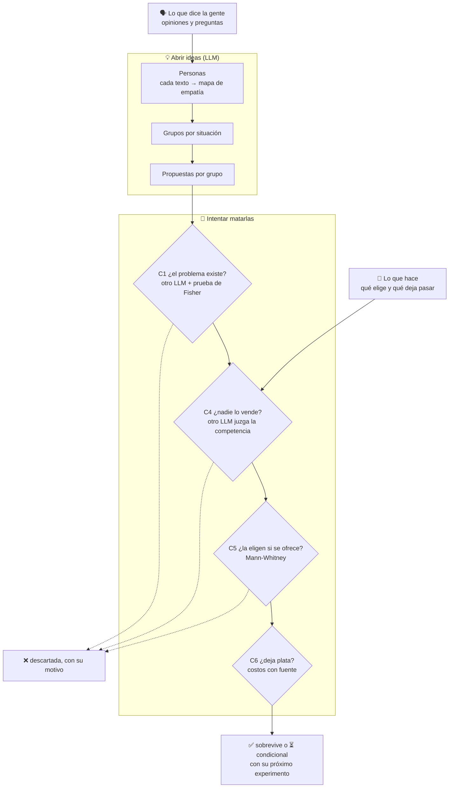

# Faltante

**Pregunta que responde:** ¿puede un sistema con un modelo de lenguaje encontrar productos que
convendría importar para vender en Mercado Libre, que nadie está trayendo y que no son obvios,
mejor que las reglas simples que usan hoy las herramientas para vendedores?

**Para quién:** importadores y vendedores chicos que deciden qué traer.

**Idea:** automatizar la función empresarial (Kirzner, Huerta de Soto): ver un desajuste
(alguien necesita algo que el mercado local no ofrece y otro ya fabrica afuera) y, antes de
recomendarlo, buscar con datos lo que lo refutaría. Solo se recomienda lo que resiste.

TP de IA Agéntica, Maestría en Explotación de Datos (UBA), 2026.

## Cómo funciona

Parte de dos cosas que la gente muestra en Mercado Libre: **lo que hace** (en cada búsqueda, qué
elige y qué deja pasar) y **lo que dice** (opiniones de compradores y preguntas de indecisos).

1. **Abrir ideas.** Un LLM lee cada opinión como una persona (situación, qué quiere lograr, qué le
   molesta, con qué compara), junta a la gente que está en la misma situación aunque haya
   comprado cosas distintas ("corta el pelo en casa a sus hijos") y propone qué traerle a cada
   grupo.
2. **Intentar matarlas.** Cada propuesta tiene que pasar cuatro preguntas, y en cada una hay un
   dato que puede tirarla abajo:
   - **C1** ¿Ese problema le pasa de verdad a esa gente, más que a gente al azar?
   - **C4** ¿Nadie lo vende ya en Mercado Libre? (C3, antes, pide que haya demanda de origen)
   - **C5** Cuando alguien lo ofrece, ¿la gente lo compra o lo deja pasar?
   - **C6** ¿Deja plata después de comisión, impuestos, envío, publicidad y devoluciones?

La regla de fondo: **el modelo que propone nunca es el que evalúa.** El problema lo mide otro
modelo que no sabe qué se propuso; la competencia la juzga otro; las cuentas las hace el código.



**Ejemplo real (dev).** Entre las opiniones de máquinas de cortar pelo aparece gente como "la
compré para mi hija pero la uso más yo". El LLM arma el grupo "corta el pelo en casa" y propone
una guía con nivel para cortarse el flequillo. **C1:** otro modelo lee 150 textos de esos
productos y 150 al azar: 18 tienen ese miedo sin resolver, contra 0 al azar. **C4:** hay 8 guías
publicadas y ninguna vendió +100; todas llegan solo por Compra Internacional (hueco de acceso).
**C5:** nadie tuvo la opción local de dejarla pasar. **C6:** al precio que se pide deja 22% neto,
pero nadie lo pagó todavía: **condicional**, el próximo experimento es probar el precio.
**Una que murió:** un quitapelos de mascotas pasaba C4 porque el criterio de qué era competencia
lo escribía el mismo LLM que lo propuso; en la búsqueda había uno con +10.000 vendidos. Desde
entonces la competencia la juzga otro modelo.

## ¿Sirve? Resultados

Tres comparaciones, prerregistradas antes de correrlas (`data/evaluacion/test/PRERREGISTRO.md`),
cada una contra un rival distinto:

| Rival | Qué hace | Qué responde |
|---|---|---|
| **B1, B2** (sin LLM) | B1 mejora el producto por su queja más frecuente (lo que sugieren las herramientas comerciales); B2 detecta pedidos de repuesto | ¿le gana a las reglas de hoy? |
| **B4** (one-shot) | el mismo modelo, una llamada por producto: lee las opiniones y lo que se ofrece en la búsqueda, se aplica él mismo los cinco criterios y recomienda | ¿le gana a preguntarle al modelo qué importar? |
| **B3** (ablación) | el mismo modelo propone directo, sin personas ni grupos, y pasa por **nuestro** embudo | ¿leer personas y grupos genera mejores ideas? |

**1. Contra las reglas sin LLM, el sistema gana.** Mismo embudo para todos; se cuentan las
oportunidades distintas que no descarta:

| | Programa | B1 | B2 |
|---|---|---|---|
| **test** (136 productos, una sola corrida) | **16** de 109 propuestas | 4 de 136 | 0 de 3 |
| test limpio (90 productos que ninguna versión leyó antes) | **12** de 61 | 4 de 90 | 0 |
| dev (133 productos) | 13 de 135 | 7 de 133 | 2 de 7 |

15% de sus propuestas resiste contra 4% (Fisher unilateral, p = 0,002; en el test limpio,
p = 0,003). Es una sola corrida de un LLM que varía bastante (en el dev chico, la misma versión
dejó 14, 3 y 9), pero la dirección se repitió en dev y en test. Las de B1 no son productos ("una
versión que resuelva la queja 'algo'"); las del programa sí (soga de saltar sin cable, barras de
techo inflables, adaptador digital de torque…).

**2. Contra preguntarle al modelo (B4), el sistema todavía no tiene veredicto.** B4 es mucho más
conservador: recomienda 10 productos en test y 10 en dev. Pasadas por el embudo, **los datos del
mercado refutan 9 de 10 en cada partición**: ya hay 4 a 31 publicaciones equivalentes que venden
(un probador de tomacorriente, una lámpara de emergencia), la gente deja pasar lo que se ofrece
parecido, o el problema no aparece más que en gente al azar. Esa auditoría es descriptiva (el
embudo es nuestro y las del programa lo pasan por construcción). La medida principal es el
**juicio humano a ciegas** de las recomendaciones finales de los dos, mezcladas
(`data/evaluacion/humano/`): está en curso. Con la primera de cuatro personas, 12 de las 16 del
programa en test son concretas, no obvias y las cotizaría; de B1, ninguna.

**3. Leer personas y grupos no genera mejores ideas que pedírselas directo al modelo (B3).**
Con el mismo embudo, B3 deja más: 44 contra 16 en test (18% contra 15% de sus propuestas,
p = 0,45) y 31 contra 13 en dev. Por la regla escrita antes de correrlo, **lo que aporta el
sistema es el embudo que intenta refutar cada idea, no la forma de generarlas**. Juntando 2 y 3:
el modelo solo recomienda con confianza cosas que el mercado ya resuelve; el mismo modelo, obligado
a pasar por los datos, deja ideas que resisten.

**Análisis de fallas (test).** De las 109 propuestas del programa, 30 mueren en C1 (el problema
no aparece más que en gente al azar, o aparece en un solo producto), 45 en C4 (ya hay 3 o más que
lo venden) y 18 en C5 (se ofrece y la gente lo deja pasar): el embudo mata el 85%. Ninguna llega
a "sobrevive": las 16 quedan condicionales porque no hay precio de proveedor o nadie lo compró
todavía, y el experimento siguiente es cotizar y probar el precio. Cada una con su motivo en
`data/serendipia/embudo_escala_test_api.json`; el resumen, en `data/evaluacion/test/`.

**Las piezas del embudo se ganaron su lugar con evidencia.** Se compararon en dev con 3 corridas
y una regla escrita antes (`DECISIONES.md`, `data/evaluacion/`): el dolor medido como chequeo
mejoró y como filtro previo no; obligar a los grupos a cruzar búsquedas empeoró y se sacó; el
juez de competencia independiente acertó 32 de 40 desacuerdos a ciegas contra 8 del criterio
viejo. Leer personas en vez de productos multiplicó por 10 las ideas que sobreviven frente a la
versión anterior del programa, pero no frente a B3: esa pieza queda en duda.

**Ningún número está elegido a ojo.** Margen mínimo: la ganancia neta del comercio minorista
(Damodaran, 5,19%). "Ya atendido": 3 o más competidores que venden (Bresnahan y Reiss, 1991).
"La dejan pasar": Mann-Whitney al 5%. Personas medidas en C1: análisis de potencia. Costos de
publicidad, devoluciones, comisión e IIBB: con fuente y en tres escenarios. Cada número dice de
dónde sale en `harness/umbrales.py`, `harness/costo_puesto.py` y `harness/dolor.py`.

## Costo y modelo

Una corrida completa sobre ~135 productos (≈9.000 personas):

| Paso | Llamadas | USD | Tiempo |
|---|---|---|---|
| Leer personas, agrupar, proponer, medir el dolor (C1) | ~1.300 | 3,40 | 22 min |
| Juez de competencia (C4 a C6) | ~180 | 1,79 | 16 min |
| Capturar las búsquedas nuevas en el navegador | ~90 páginas | 0 | ~10 min |
| **Total** | | **≈ 5,20** (≈ USD 0,04 por propuesta) | **≈ 50 min** |

Modelo: **DeepSeek V4.1 Flash** (USD 0,30 / 1,20 por millón de tokens de entrada / salida; la
mitad fuera de hora pico). La versión Pro cuesta 4,4 veces más por token de entrada. Leer y
asignar personas va sin razonamiento (es clasificar); proponer y juzgar, con razonamiento.
Elegimos Flash porque la tarea pide escala (miles de personas) y los dos jueces quedaron
validados con controles; no lo comparamos contra Pro (queda como trabajo futuro). Cada llamada
queda en la traza con tokens, segundos, errores del guardrail y si se cortó.

## Correrlo

Requisitos: Python 3 (la imagen de Docker usa 3.12; los tests también pasan con 3.14), `make` y
las dependencias de `requirements.txt` (`pytest>=8`, `scipy>=1.11`). `make test` y `make todo`
no necesitan internet ni claves; solo `make serendipia-api` pide `DEEPSEEK_API_KEY`. Sin venv,
`make test` falla con "No module named pytest".

```bash
git clone https://github.com/codewithpatelo/faltante && cd faltante
python3 -m venv .venv && source .venv/bin/activate
make setup     # dependencias
make todo      # tests + el embudo sobre las corridas guardadas de dev y test y el resultado de la hipótesis (sin internet ni claves)
```

O con Docker: `docker build -t faltante . && docker run faltante`. Para correr el modelo (la
clave es un secreto del repo): pestaña Actions → workflow **llm** → tarea `serendipia` con la
partición; después capturar las búsquedas nuevas (`scripts/captura_ml.js`), correr la tarea
`equivalencias` y `python -m harness.correr <particion>_api`.

## Datos

| Qué | Volumen | Dónde |
|---|---|---|
| Productos ancla: los 2 más vendidos de cada búsqueda | dev: 133 productos de 71 búsquedas; test: 136 de 71, apartados por hash de la búsqueda antes de leerlos | `data/escala/corpus_*.json` |
| Cómo se eligieron las búsquedas | 99 categorías hoja del árbol de Mercado Libre sorteadas en proporción a sus publicaciones, en 9 rubros de consumo importables, más 47 del corpus inicial | `scripts/muestrear_categorias.js` |
| Opiniones y preguntas | 43.900 textos (dev: 21.745 → 9.205 personas; test: 22.155 → 8.585) | mismos archivos |
| Búsquedas capturadas (para C3 a C6) | 1.044 búsquedas | `data/capturas/` |
| Precios de proveedor | Alibaba con el descuento citado para 1688 y la comisión del agente: estimados | `data/serendipia/fob_*.json` |

Fuente: páginas públicas de Mercado Libre leídas desde un navegador con sesión iniciada (la API
de búsqueda devuelve 403), noviembre 2026; solo texto visible, sin nombres de usuarios; uso
académico.

## Qué podría tirar esto abajo

Buscamos a propósito los supuestos que, si fallan, invalidan el resultado, y medimos los que se
podían medir:

- **Rivales débiles.** Ganarle a reglas sin LLM prueba poco: por eso B4 (el modelo solo, de
  punta a punta) y B3 (la generación sola). B3 sí le ganó a la generación del programa (arriba).
- **El LLM escribe la búsqueda con la que después se lo juzga.** Una búsqueda rebuscada trae pocos
  competidores y pasa C4 sola. Medido: las que quedan no tienen búsquedas con menos resultados
  que las que mueren (mediana 246 contra 231 en dev, p = 0,89; 167 contra 205 en test, p = 0,32).
  Hay casos sueltos (una búsqueda devolvió 5 resultados), y B3 también escribe las suyas.
- **El dolor se mide con los mismos textos de donde salió la idea.** Si se saca a las personas que
  el LLM citó, las propuestas con dolor significativo bajan de 257 a 238 (7%): pesa poco.
- **El mismo modelo propone y juzga.** Los jueces son llamadas aparte que no saben qué método
  propuso, así que un sesgo a favor de lo propio (Zheng et al., 2023) favorece igual al programa
  y a B3. Contra la primera persona que juzgó a ciegas (1 de 4), el juez de competencia coincide
  en 75% (kappa 0,22); el de dolor, poco (kappa −0,05): ve la mitad del dolor que ve ella, con
  precisión 0,8. Es conservador, así que mata de más, no de menos (`data/evaluacion/humano/`).
- **"No descartada" no es "buena".** Ninguna llega a "sobrevive": todas quedan condicionales
  porque el precio de proveedor es estimado y nadie lo pagó todavía. El conteo dice que ningún
  dato la refutó, no que sea rentable; eso lo dicen el juicio humano a ciegas y una cotización.
- **Una sola corrida en test**, con un LLM que varía entre corridas, y 46 de sus 136 productos ya
  se habían leído antes (por eso el subconjunto limpio).
- **Datos:** "+N vendidos" es un piso, no las ventas; C5 no puede descartar lo que casi no tiene
  alternativas; la logística supone carga consolidada (un importador chico trae por courier); el
  corpus ampliado no tiene preguntas de indecisos.

## Mapa del repo

`harness/` el programa (`personas.py` pasos de lectura y grupos; `divergente.py` propuestas y
medición del dolor; `dolor.py` C1; `equivalencias.py` juez de competencia; `chequeos.py` y
`embudo.py` los supuestos críticos; `baselines.py` B1 y B2; `directo.py` B3 y B4; `modelo.py` cliente, reintentos y
costo) · `skills/` un skill por paso del LLM · `scripts/` captura desde el navegador ·
`tests/` · `data/evaluacion/` cada comparación con su prerregistro · `CONSIGNA.md` cumplimiento
de la consigna, áreas en profundidad y antecedentes · `DECISIONES.md` qué elegimos y con qué
evidencia · `BITACORA.md` cómo llegamos acá, con lo que no funcionó · `AGENTS.md` reglas para
los asistentes de código.
