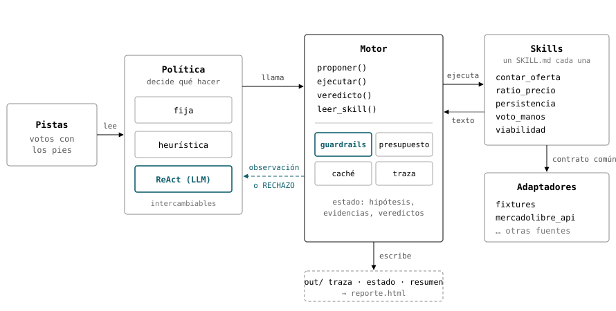

# Faltante

TP de IA Agéntica (UBA, 2026). Tomamos productos que se venden mucho afuera (top de Amazon
en Cocina) y nos preguntamos **por qué no se venden en Mercado Libre**. Cuatro explicaciones
compiten: **precio** (cuesta mucho más que lo que la gente compra), **espera** (la gente no
quiere esperar el envío de afuera), **preferencia** (hay alternativas que gustan más) y
**falta de demanda**. El sistema corre las cuatro y se queda con la que sostienen los datos.

Usamos **votos con los pies**: lo que la gente compra ("+N vendidos" en cada publicación),
no lo que dice que compraría.

## Qué encontramos (23 productos, fotos del 29/10 y del 05/11/2026)

| Conclusión | Productos | Qué significa |
|---|---|---|
| No compite en precio | 16 | cuesta entre 2 y 8 veces lo que se vende en su búsqueda |
| Ya se vende acá | 4 | hay stock local con ventas (Owala FreeSip, Stanley Quencher, KitchenAid) |
| Candidato a probar | 2 | precio parecido y nadie lo vende con stock local (mixer Turelar, Owala SmoothSip) |
| Sin demanda | 1 | nadie compra nada en la búsqueda (YETI Rambler) |

Las dos fotos, tomadas con una semana de diferencia, dan **las mismas 23 conclusiones**.
De las publicaciones internacionales de estos productos, **ninguna muestra ventas**: en los
4 productos que están en los dos canales, la gente compra el de stock local aunque el
internacional cueste igual o menos.

## Correrlo (sin red ni claves)

```bash
git clone https://github.com/codewithpatelo/faltante && cd faltante
python3 -m venv .venv && source .venv/bin/activate
make setup        # instala dependencias
make todo         # tests + demo del harness + diagnóstico sobre la foto más reciente
```

Por separado:

```bash
make test         # 18 tests: guardrails, chequeos, emparejamiento
make diagnostico  # cuatro chequeos sobre la foto más reciente de data/diagnostico/
make demo         # políticas fija y heurística sobre datos sintéticos (prueban el mecanismo)
make agente       # agente ReAct con LLM (requiere ANTHROPIC_API_KEY)
```

Con Docker: `docker build -t faltante . && docker run --rm faltante`

## Refrescar los datos de Mercado Libre

La API de búsqueda de Mercado Libre devuelve **403 sin token**, desde la nube y desde una
conexión hogareña (probado el 05/11/2026), y la web bloquea scripts comunes. Lo que sí
funciona es leer el listado desde tu navegador con sesión iniciada:

1. Abrí `https://listado.mercadolibre.com.ar/termo` con tu sesión de Mercado Libre.
2. Abrí la consola (F12 → Consola), pegá entero `scripts/captura_ml.js` y Enter.
   Tarda unos 8 minutos y descarga `captura_ml_<fecha>.json`. No toca cookies ni datos de tu cuenta.
3. Copiá el archivo a `data/capturas/` y corré:

```bash
make foto CAPTURA=data/capturas/captura_ml_<fecha>.json   # marca producto / sustituto / accesorio
make diagnostico                                           # usa la foto nueva
```

Para probar la API con una app propia de Mercado Libre: `make prueba-api` (pide Client ID y
Secret Key sin mostrarlos y no los guarda). Si con token la búsqueda responde, `make vivo`
corre el harness contra la API.

## Cómo está armado



```
productos con demanda afuera
   │
   ▼
POLÍTICA ─── decide qué chequear ──►  MOTOR ─── guardrails, caché, traza
(fija | heurística | diagnóstico | LLM)  │
                                         ▼
                                  SKILLS ──► ADAPTADORES (foto de ML | API de ML | sintéticos)
```

- **`harness/motor.py`**: ejecuta lo que la política pide y hace cumplir las reglas; no decide.
  Operaciones: `proponer_hipotesis`, `verificar`, `dar_veredicto`, `leer_skill`.
- **`harness/diagnostico.py`**: los cuatro chequeos. Los umbrales están arriba del archivo,
  a la vista, porque son decisiones discutibles.
- **`harness/agente.py`**: loop ReAct sobre la API de Anthropic, sin framework.
- **`harness/politicas.py`**: fija, heurística y diagnóstico (los baselines contra los que
  se compara el agente).
- **`skills/*/SKILL.md`**: una por verificación: qué pregunta responde, cuándo usarla, cómo
  leer el resultado.
- **`adapters/`**: de dónde salen los datos. Cambiar de fuente no toca el harness.
- **`scripts/`**: captura desde el navegador, emparejamiento por reglas, prueba de la API.

### Guardrails (en código)

- No se puede confirmar ni descartar sin al menos una evidencia **propia, exitosa y que haya
  tocado datos**. Si no se pudo verificar, el veredicto es `insuficiente`.
- Tope de skills por hipótesis y de pasos totales.
- No se puede terminar con productos sin veredicto.
- Todo rechazo vuelve a la política como error y queda en la traza.

## Dónde está el LLM

En **emparejar**: decidir si cada publicación de Mercado Libre es el producto de Amazon, un
sustituto o un accesorio. La búsqueda de Mercado Libre mezcla todo, y una regla simple
("menciona la marca") acertó 4 de 15 en la prueba. Hoy el criterio por producto
(`data/diagnostico/criterios.json`) lo escribió el LLM en el chat y se aplica con reglas
(`scripts/emparejar.py`). Pendiente: hacer el emparejamiento con el LLM publicación por
publicación y compararlo contra estas reglas.

## Limitaciones que declaramos

- Primera página de cada búsqueda, 23 productos, una categoría.
- "+N vendidos" es un piso del contador, no ventas reales.
- El criterio de emparejamiento tiene errores conocidos (ver `BITACORA.md`).
- No sabemos si el precio internacional incluye impuestos de importación.

## Archivos para leer primero

- `BITACORA.md`: qué probamos, qué esperábamos, qué pasó, qué decidimos, en orden.
- `DECISIONES.md`: por qué el diseño es como es.
- `data/diagnostico/resultado_<fecha>.json`: cada producto con los números de cada chequeo.
