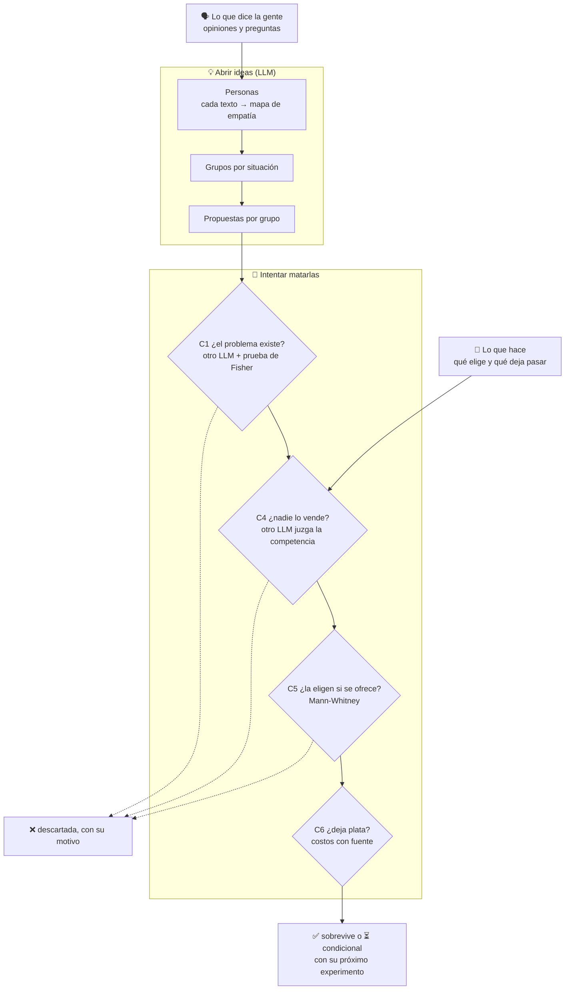

# Faltante

**Pregunta que responde:** ¿puede un sistema con un modelo de lenguaje encontrar productos que
convendría importar para vender en Mercado Libre, que nadie está trayendo y que no son obvios,
mejor que las reglas simples que usan hoy las herramientas para vendedores?

**Para quién:** importadores y vendedores chicos que deciden qué traer.

**Idea:** automatizar la función empresarial (Kirzner, Huerta de Soto): ver un desajuste
(alguien necesita algo que el mercado local no ofrece y otro ya fabrica afuera) y, antes de
recomendarlo, buscar con datos lo que lo refutaría. Solo se recomienda lo que resiste.

TP de IA Agéntica, Maestría en Explotación de Datos (UBA), 2026.

## Cómo funciona

Parte de dos cosas que la gente muestra en Mercado Libre: **lo que hace** (en cada búsqueda, qué
elige y qué deja pasar) y **lo que dice** (opiniones de compradores y preguntas de indecisos).

1. **Abrir ideas.** Un LLM lee cada opinión como una persona (situación, qué quiere lograr, qué le
   molesta, con qué compara), junta a la gente que está en la misma situación aunque haya
   comprado cosas distintas ("corta el pelo en casa a sus hijos") y propone qué traerle a cada
   grupo.
2. **Intentar matarlas.** Cada propuesta tiene que pasar cuatro preguntas, y en cada una hay un
   dato que puede tirarla abajo:
   - **C1** ¿Ese problema le pasa de verdad a esa gente, más que a gente al azar?
   - **C4** ¿Nadie lo vende ya en Mercado Libre? (C3, antes, pide que haya demanda de origen)
   - **C5** Cuando alguien lo ofrece, ¿la gente lo compra o lo deja pasar?
   - **C6** ¿Deja plata después de comisión, impuestos, envío, publicidad y devoluciones?

La regla de fondo: **el modelo que propone nunca es el que evalúa.** El problema lo mide otro
modelo que no sabe qué se propuso; la competencia la juzga otro; las cuentas las hace el código.



**Ejemplo real (dev).** Entre las opiniones de máquinas de cortar pelo aparece gente como "la
compré para mi hija pero la uso más yo". El LLM arma el grupo "corta el pelo en casa" y propone
una guía con nivel para cortarse el flequillo. **C1:** otro modelo lee 150 textos de esos
productos y 150 al azar: 18 tienen ese miedo sin resolver, contra 0 al azar. **C4:** hay 8 guías
publicadas y ninguna vendió +100; todas llegan solo por Compra Internacional (hueco de acceso).
**C5:** nadie tuvo la opción local de dejarla pasar. **C6:** al precio que se pide deja 22% neto,
pero nadie lo pagó todavía: **condicional**, el próximo experimento es probar el precio.
**Una que murió:** un quitapelos de mascotas pasaba C4 porque el criterio de qué era competencia
lo escribía el mismo LLM que lo propuso; en la búsqueda había uno con +10.000 vendidos. Desde
entonces la competencia la juzga otro modelo.

## ¿Sirve? Resultados

**Hipótesis** (prerregistrada en `data/evaluacion/test/PRERREGISTRO.md`): con el mismo embudo, el
LLM deja más oportunidades distintas no descartadas que dos baselines sin LLM: **B1**, mejorar el
producto por su queja más frecuente (lo que sugieren las herramientas comerciales), y **B2**, una
regla que detecta pedidos de repuesto.

| Oportunidades distintas no descartadas (sobreviven o quedan condicionales) | LLM | B1 | B2 |
|---|---|---|---|
| dev (133 productos) | **13** de 135 propuestas | 7 de 133 | 2 de 7 |
| test (136 productos, una sola corrida) | pendiente: falta el juez de competencia | | |

En dev, las 13 del LLM son productos concretos (un extractor con sensor de humedad, un kit de
detección de fugas con UV, una barra de enchufes con abrazadera, cabezales descartables para la
escobilla del inodoro…); las 7 de B1 son "una versión que resuelva la queja 'bueno'" o
"'saludos'": no se pueden cotizar. Ninguna llega a "sobrevive": todas quedan condicionales a una
cotización o a probar el precio, que es el experimento siguiente. Dónde muere cada una y por qué:
`data/serendipia/embudo_escala_dev_api.json`.

**Cada pieza se ganó su lugar con evidencia.** Las versiones se compararon en dev con 3 corridas
y una regla escrita antes (`DECISIONES.md`, `data/evaluacion/`): leer personas en vez de
productos multiplicó por más de 10 las ideas que sobreviven; obligar a los grupos a cruzar búsquedas
empeoró y se sacó; un filtro de dolor antes de proponer no mejoró y se sacó; el mismo dolor
medido como chequeo, sí; y el juez de competencia independiente acertó 32 de 40 desacuerdos a
ciegas contra 8 del criterio viejo.

**Ningún número está elegido a ojo.** Margen mínimo: la ganancia neta del comercio minorista
(Damodaran, 5,19%). "Ya atendido": 3 o más competidores que venden (Bresnahan y Reiss, 1991).
"La dejan pasar": Mann-Whitney al 5%. Personas medidas en C1: análisis de potencia. Costos de
publicidad, devoluciones, comisión e IIBB: con fuente y en tres escenarios. Cada número dice de
dónde sale en `harness/umbrales.py`, `harness/costo_puesto.py` y `harness/dolor.py`.

## Costo y modelo

Una corrida completa sobre ~135 productos (≈9.000 personas):

| Paso | Llamadas | USD | Tiempo |
|---|---|---|---|
| Leer personas, agrupar, proponer, medir el dolor (C1) | ~1.300 | 3,40 | 22 min |
| Juez de competencia (C4 a C6) | ~180 | 1,79 | 16 min |
| Capturar las búsquedas nuevas en el navegador | ~90 páginas | 0 | ~10 min |
| **Total** | | **≈ 5,20** (≈ USD 0,04 por propuesta) | **≈ 50 min** |

Modelo: **DeepSeek V4.1 Flash** (USD 0,30 / 1,20 por millón de tokens de entrada / salida; la
mitad fuera de hora pico). La versión Pro cuesta 4,4 veces más por token de entrada. Leer y
asignar personas va sin razonamiento (es clasificar); proponer y juzgar, con razonamiento.
Elegimos Flash porque la tarea pide escala (miles de personas) y los dos jueces quedaron
validados con controles; no lo comparamos contra Pro (queda como trabajo futuro). Cada llamada
queda en la traza con tokens, segundos, errores del guardrail y si se cortó.

## Correrlo

```bash
git clone https://github.com/codewithpatelo/faltante && cd faltante
python3 -m venv .venv && source .venv/bin/activate
make setup     # dependencias
make todo      # tests + el embudo sobre la última corrida guardada (sin internet ni claves)
```

O con Docker: `docker build -t faltante . && docker run faltante`. Para correr el modelo (la
clave es un secreto del repo): pestaña Actions → workflow **llm** → tarea `serendipia` con la
partición; después capturar las búsquedas nuevas (`scripts/captura_ml.js`), correr la tarea
`equivalencias` y `python -m harness.correr <particion>_api`.

## Datos

| Qué | Volumen | Dónde |
|---|---|---|
| Productos ancla: los 2 más vendidos de cada búsqueda | dev: 133 productos de 71 búsquedas; test: 136 de 71, apartados por hash de la búsqueda antes de leerlos | `data/escala/corpus_*.json` |
| Cómo se eligieron las búsquedas | 99 categorías hoja del árbol de Mercado Libre sorteadas en proporción a sus publicaciones, en 9 rubros de consumo importables, más 47 del corpus inicial | `scripts/muestrear_categorias.js` |
| Opiniones y preguntas | 43.900 textos (dev: 21.745 → 9.205 personas; test: 22.155 → 8.585) | mismos archivos |
| Búsquedas capturadas (para C3 a C6) | 1.044 búsquedas | `data/capturas/` |
| Precios de proveedor | Alibaba con el descuento citado para 1688 y la comisión del agente: estimados | `data/serendipia/fob_*.json` |

Fuente: páginas públicas de Mercado Libre leídas desde un navegador con sesión iniciada (la API
de búsqueda devuelve 403), noviembre 2026; solo texto visible, sin nombres de usuarios; uso
académico.

## Limitaciones

- Los precios de proveedor son estimados; el real lo da una cotización. La logística supone carga
  consolidada; un importador chico suele traer por courier.
- "+N vendidos" es un piso del contador de Mercado Libre, no las ventas exactas.
- C5 deja pasar lo que tiene pocas alternativas ofrecidas: sin alternativas no se puede probar que
  la gente las deje pasar.
- Los jueces de dolor y competencia son LLM: se validaron con controles y etiquetado a ciegas; la
  calibración contra el grupo está en `data/evaluacion/humano/`.
- B1 cuenta como "no descartadas" propuestas que no son productos ("resolver la queja 'bueno'"):
  el conteo no mide calidad, y por eso hace falta el juicio humano.
- Las opiniones del corpus ampliado no incluyen preguntas de indecisos.

## Mapa del repo

`harness/` el programa (`personas.py` pasos de lectura y grupos; `divergente.py` propuestas y
medición del dolor; `dolor.py` C1; `equivalencias.py` juez de competencia; `chequeos.py` y
`embudo.py` los supuestos críticos; `baselines.py` B1 y B2; `modelo.py` cliente, reintentos y
costo) · `skills/` un skill por paso del LLM · `scripts/` captura desde el navegador ·
`tests/` · `data/evaluacion/` cada comparación con su prerregistro · `CONSIGNA.md` cumplimiento
de la consigna, áreas en profundidad y antecedentes · `DECISIONES.md` qué elegimos y con qué
evidencia · `BITACORA.md` cómo llegamos acá, con lo que no funcionó · `AGENTS.md` reglas para
los asistentes de código.
